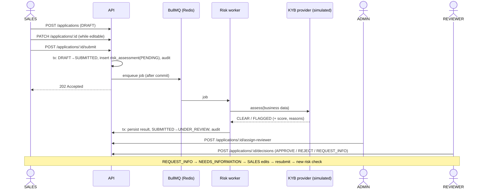
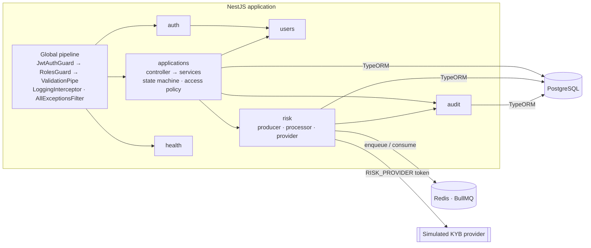
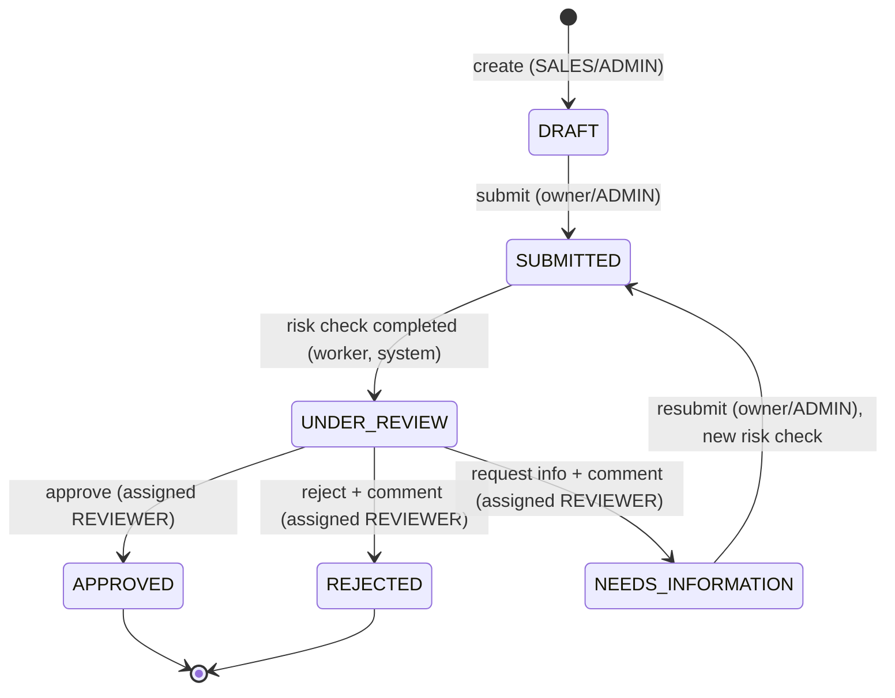
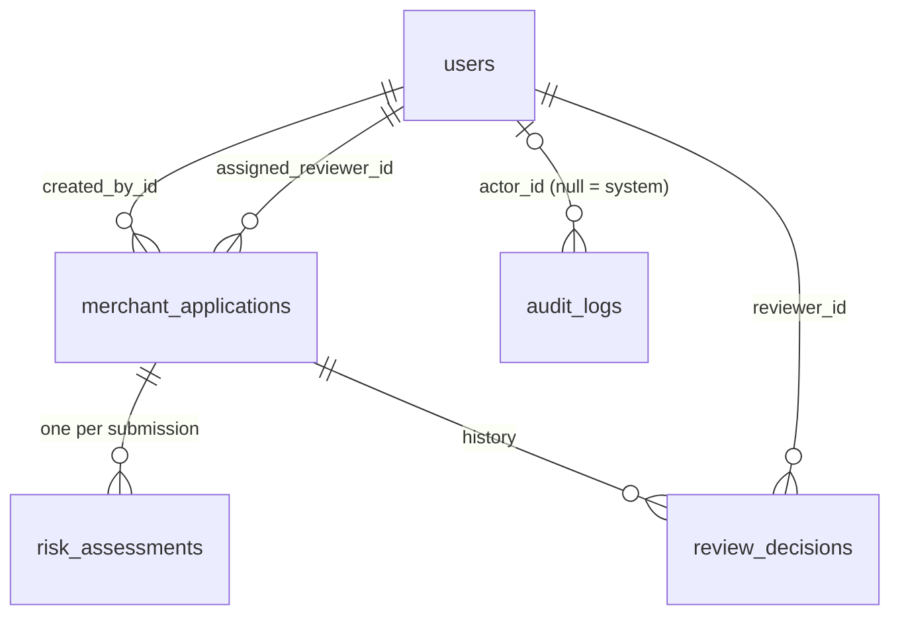

# Merchant Onboarding & Risk Review Backend

Internal backend for a payment service provider's merchant onboarding. SALES staff capture merchant applications, an asynchronous KYB/risk check runs in the background, and an assigned REVIEWER makes the final decision. Every significant action is audited.

Built with **NestJS 11 · TypeScript (strict) · PostgreSQL + TypeORM · BullMQ + Redis · JWT · Swagger · Jest + Supertest · Docker Compose**.

> Scope: this is the internal, employee-facing API only. There is no merchant portal, checkout or payment processing.

---

## Contents

1. [Quick start](#1-quick-start)
2. [Business workflow](#2-business-workflow)
3. [Architecture](#3-architecture)
4. [Roles and permissions](#4-roles-and-permissions)
5. [API](#5-api)
6. [Application state machine](#6-application-state-machine)
7. [Asynchronous risk review](#7-asynchronous-risk-review)
8. [Data model](#8-data-model)
9. [Security and sensitive data](#9-security-and-sensitive-data)
10. [Testing](#10-testing)
11. [Trade-offs and known limitations](#11-trade-offs-and-known-limitations)
12. [AI assistance disclosure](#12-ai-assistance-disclosure)

---

## 1. Quick start

**Prerequisites:** Node.js 20+ (developed on 24), npm, Docker with Compose v2.

```bash
# 1. Configure: copy the template and replace every <placeholder>
cp .env.example .env
#    JWT_SECRET:          openssl rand -base64 48
#    DATABASE_PASSWORD:   any local password
#    SEED_USER_PASSWORD:  password for the demo users (min 8 chars)

# 2. Start PostgreSQL (host port 5433) and Redis (host port 6380)
docker compose up -d

# 3. Install, migrate, seed
npm ci
npm run migration:run
npm run seed

# 4. Run (API + risk worker in one process)
npm run start:dev
```

| URL | Purpose |
|---|---|
| http://localhost:3000/docs | Swagger UI. Click **Authorize** and paste the `accessToken` returned by `POST /auth/login`. |
| http://localhost:3000/health | Liveness/readiness (PostgreSQL + Redis) |

**Demo users** (created by `npm run seed`, all using `SEED_USER_PASSWORD`):

| Email | Role |
|---|---|
| `admin@example.com` | ADMIN |
| `sales.one@example.com`, `sales.two@example.com` | SALES |
| `reviewer.one@example.com`, `reviewer.two@example.com` | REVIEWER |

Two users per role make it easy to try the object-level rules by hand: one SALES user's applications are invisible to the other.

**Other commands**

```bash
npm run test           # unit tests
npm run test:e2e       # API integration tests (needs `docker compose up -d`)
npm run lint
npm run build && npm start
npm run migration:revert
npm run typeorm -- schema:log   # must print "Your schema is up to date"
```

**Demo the simulated KYB provider.** It is deterministic:

| Input | Result |
|---|---|
| Ordinary merchant, e.g. MCC `5814` | `CLEAR`, `LOW` |
| High-risk MCC (`4829`, `5967`, `5993`, `6051`, `7995`) | `FLAGGED`, `HIGH` |
| No website, monthly volume > 1,000,000, or average ticket > 5,000 | Adds to the score |
| Business name containing `[simulate-provider-outage]` | Provider throws: shows retries, then `FAILED`, then the admin retry |

---

## 2. Business workflow



---

## 3. Architecture

A **modular monolith**: one deployable unit with clear module boundaries. That's simple to run and reason about, and the queue boundary allows the worker to be split out later.



| Module | Responsibility |
|---|---|
| `auth` | Login, JWT issuing/validation, global auth guard, login rate limiting |
| `users` | User entity, lookups, password hashing (bcrypt) |
| `applications` | REST API, `ApplicationsService` (CRUD), `ApplicationWorkflowService` (submit, assign, decide, retry), the pure **state machine** and the **access policy** |
| `risk` | BullMQ producer and worker, `RiskProvider` abstraction plus a deterministic simulator |
| `audit` | Append-only audit trail, written inside the caller's transaction, with masking applied centrally |
| `common` | Decorators, `RolesGuard`, exception filter, logging interceptor, masking utils |
| `config`, `database`, `health` | Env validation (fail fast), TypeORM config, migrations, seed, health check |

**Conventions**
- Controllers are thin. Business rules live in services, the state machine and the policy.
- DTOs validate all input (`whitelist` + `forbidNonWhitelisted`, so unknown fields return 400).
- Responses are explicit response DTOs; entities are never returned.
- Domain errors carry no HTTP knowledge (`InvalidStateTransitionError`); the global filter maps them to 409.

---

## 4. Roles and permissions

| Action | SALES | REVIEWER | ADMIN |
|---|---|---|---|
| Create application | ✅ (becomes owner) | ❌ 403 | ✅ |
| List / view | **own only** | **assigned only** | all |
| Edit (DRAFT, NEEDS_INFORMATION) | **own only** | ❌ 403 | ✅ |
| Submit / resubmit | **own only** | ❌ 403 | ✅ |
| Assign reviewer | ❌ 403 | ❌ 403 | ✅ |
| Approve / reject / request info | ❌ 403 | **assigned reviewer only** | ❌ 403 |
| Retry a failed risk check | ❌ 403 | ❌ 403 | ✅ |
| View risk assessments, decisions, audit trail | own only | assigned only | all |

**How it's enforced: three independent layers**

1. **Role gate:** `@Roles(...)` plus the global `RolesGuard` (403).
2. **Visibility scope, inside the SQL query:** `ApplicationAccessPolicy.applyVisibilityScope` adds `created_by_id = :me` (SALES) or `assigned_reviewer_id = :me` (REVIEWER). Every read and write loads the application through this scope, so an out-of-scope application is never loaded and the API answers **404, identical to a non-existent id**. IDs cannot be probed.
3. **Action rules:** `assertCanModify`, `assertCanDecide` and `assertCanAssign` re-check ownership and assignment on the loaded row (403).

Each layer is sufficient on its own. During development each one was disabled in turn to confirm the remaining layers and the tests still catch the bypass. ADMIN deliberately **cannot** record decisions: the brief says only the assigned reviewer may.

---

## 5. API

Full interactive documentation is at `/docs` (Swagger). All routes except login and health require `Authorization: Bearer <token>`.

| Method | Path | Description | Success |
|---|---|---|---|
| POST | `/auth/login` | Email/password → JWT | 200 |
| GET | `/auth/me` | Current user profile | 200 |
| GET | `/health` | DB + Redis check | 200 / 503 |
| POST | `/applications` | Create (DRAFT) | 201 |
| GET | `/applications?status=&page=&limit=` | List (scoped, filter, paginated, newest first) | 200 |
| GET | `/applications/:id` | Get one | 200 |
| PATCH | `/applications/:id` | Update while editable | 200 |
| POST | `/applications/:id/submit` | Submit, starts the async risk check | **202** |
| POST | `/applications/:id/assign-reviewer` | `{ reviewerId }` | 200 |
| POST | `/applications/:id/decisions` | `{ decision, comment? }` | 201 |
| GET | `/applications/:id/decisions` | Decision history | 200 |
| GET | `/applications/:id/risk-assessments` | One per submission, newest first | 200 |
| POST | `/applications/:id/risk-assessments/retry` | Re-run a FAILED or stuck check | **202** |
| GET | `/applications/:id/audit-logs` | Audit trail (masked) | 200 |

**Error format** (every error, via `AllExceptionsFilter`):

```json
{ "statusCode": 409, "error": "Conflict", "message": "Cannot edit an application in status SUBMITTED", "path": "/applications/…", "timestamp": "…" }
```

| Code | Meaning |
|---|---|
| 400 | Validation failed, unknown field, malformed UUID, or invalid reviewer |
| 401 | Missing, invalid or expired token, or deactivated user |
| 403 | Role or action not allowed on an application you can see |
| 404 | Does not exist **or** is outside your visibility |
| 409 | Invalid state transition |
| 429 | Login rate limit |

---

## 6. Application state machine



All rules are in one pure table: [`application-state-machine.ts`](src/applications/domain/application-state-machine.ts). It is unit-tested for **every (status × action) pair** (42 cases).

| Action | Allowed from | Notes |
|---|---|---|
| Edit | DRAFT, NEEDS_INFORMATION | |
| Submit | DRAFT, NEEDS_INFORMATION | Increments `submission_count`, creates risk assessment #n |
| Complete risk review | SUBMITTED | Worker only. Moves to UNDER_REVIEW and **never decides** |
| Assign reviewer | SUBMITTED, UNDER_REVIEW, NEEDS_INFORMATION | Assignment survives a resubmission |
| Approve / reject / request info | UNDER_REVIEW | So a decision always has a finished risk result. Reject and request info need a comment |

`riskStatus` is tracked separately on the application: `NOT_STARTED → PENDING → PROCESSING → CLEAR | FLAGGED | FAILED`. A FLAGGED result does not block approval. It is information for the human reviewer.

**Concurrency:** every transition runs in a transaction that locks the application row (`SELECT … FOR UPDATE`). Three simultaneous submits give one 202 and two 409s (tested).

---

## 7. Asynchronous risk review

**Producer** ([`risk-review.producer.ts`](src/risk/risk-review.producer.ts))
- Submit commits the state change and the new `risk_assessments` row first, and **enqueues only after the commit**, so the worker can never see a job whose row doesn't exist, and a rolled-back submit never leaves a ghost job.
- Job options: `attempts: 3`, exponential backoff (`RISK_JOB_BACKOFF_MS`, default 2 s), and a deterministic job id `risk-<applicationId>-<submissionNumber>`.

**Worker** ([`risk-review.processor.ts`](src/risk/risk-review.processor.ts)), concurrency 5:
1. Lock the application, then the assessment (the same order everywhere, which avoids deadlocks). If the assessment is already terminal, return `skipped`.
2. Mark it `PROCESSING` and increment `attempts`.
3. Call the `RiskProvider`. Only business data is sent; owner PII is not.
4. **On success**, in one transaction: store the score, level, reason codes and provider reference, move the application `SUBMITTED → UNDER_REVIEW`, set `riskStatus` CLEAR or FLAGGED, and audit `RISK_ASSESSMENT_COMPLETED` (actor = system). A result for an *older* submission is stored but doesn't move the application.
5. **On error:** record `lastError` and re-throw so BullMQ retries with backoff. On the **final** attempt the assessment becomes `FAILED` (the application stays SUBMITTED with `riskStatus` FAILED) and `RISK_ASSESSMENT_FAILED` is audited. An ADMIN can then `POST …/risk-assessments/retry`.

**Idempotency: three layers, each tested**

| Layer | Protects against |
|---|---|
| Deterministic BullMQ `jobId` | The same submission being enqueued twice. The second `add` is a no-op. |
| Worker skips terminal assessments (checked again under lock) | Redelivery, a duplicate job with another id, or a retry after a crash. The provider is not called again. |
| `UNIQUE (application_id, submission_number)` in PostgreSQL | Any code path creating a second assessment for the same submission |

**Provider abstraction:** the worker depends on the `RISK_PROVIDER` token. A real vendor client is a new class bound to that token. The simulator is deterministic, so tests are repeatable and never call a real third party.

---

## 8. Data model



| Table | Highlights |
|---|---|
| `users` | `uq_users_email`; `password_hash` is never selected by default; `is_active` is checked on every request |
| `merchant_applications` | Business, owner/contact and processing fields; `status`, `risk_status`, `submission_count`; CHECKs on amounts (> 0); indexes `(status)`, `(created_by_id, status)`, `(assigned_reviewer_id, status)` matching the three list scopes |
| `risk_assessments` | `UNIQUE (application_id, submission_number)`; reason codes only, no raw provider payload; `attempts`, `last_error` |
| `review_decisions` | Permanent decision history (a request-info loop produces several) |
| `audit_logs` | Append-only: a **trigger rejects UPDATE/DELETE**; index `(entity_type, entity_id, created_at)` |

**Migrations:** [`src/database/migrations`](src/database/migrations). The migration is hand-written, with named constraints (`pk_`, `fk_`, `uq_`, `chk_`, `idx_`), `ON DELETE RESTRICT` everywhere, and PostgreSQL enums. `synchronize` is off in every environment. `npm run typeorm -- schema:log` confirms the entities and the migration match exactly. `down()` is tested (revert, then re-run).

---

## 9. Security and sensitive data

**Authentication**
- bcrypt (cost 12).
- Login gives the same error and similar timing for an unknown email and a wrong password (a dummy hash is compared), so emails can't be enumerated.
- Login is rate-limited per IP (`LOGIN_RATE_LIMIT_PER_MINUTE`).
- JWT is HS256 **pinned**, which rejects `alg: none` and foreign signatures. Expiry is short (`JWT_EXPIRES_IN`).
- On every request the user is **reloaded**: deactivation applies immediately, and the role comes from the DB, not the token claim (tested).

**Secrets**
- Nothing secret is committed. `.env` is gitignored, and `.env.example` holds placeholders only.
- The app refuses to boot when `JWT_SECRET` is shorter than 32 characters, and the env validation error lists variable *names*, never values.
- Docker Compose requires the DB password from `.env`.
- The seed refuses to run in production.

**Logs**
- `LoggingInterceptor` logs method, route, status, duration and user id only. **Bodies and headers are never logged.**
- pino `redact` additionally censors `authorization`, `cookie`, `password`, `token` and owner PII paths.
- Login logs the user id and outcome, never the submitted email or password.
- Unknown errors return a generic 500 with no stack trace or SQL.

**Masking:** [`mask.ts`](src/common/utils/mask.ts) is applied centrally in `AuditService.record`:
- tax id becomes `****1234` and phone `****1234`
- email becomes `j***@example.com`
- owner name becomes initials
- secrets become `[REDACTED]`

API responses expose only `ownerTaxIdMasked`. Free-text decision comments stay in `review_decisions`; the audit entry references them by id.

**Test data:** all fixtures are obviously fictitious (`example.com`, `TEST-…` tax ids, `+1555…` numbers). There is no card data anywhere; the domain doesn't collect it.

**Fields that need field-level encryption at rest** (not implemented in this time-box):

| Column | Why |
|---|---|
| `merchant_applications.owner_tax_id` | National/business identifier: highest identity-theft and regulatory impact |
| `merchant_applications.owner_email`, `owner_phone` | Direct personal contact data (GDPR-style personal data) |
| `merchant_applications.owner_full_name` | Personal data; combined with the above it identifies a person |
| *(future)* bank account / IBAN, owner date of birth, KYB documents | Payout fraud risk and KYC data |
| `risk_assessments.reasons` / provider data, if raw vendor payloads are ever stored | Vendor KYB responses often contain PII |

Recommended approach: envelope encryption (AES-256-GCM data keys wrapped by a KMS key), applied through a TypeORM column transformer; a `key_version` for rotation; an HMAC **blind index** column where equality search is needed (e.g. duplicate-merchant detection by tax id); decryption only in the service layer for authorized roles. Disk/volume encryption and TLS to PostgreSQL and Redis are assumed at the infrastructure level.

---

## 10. Testing

```bash
docker compose up -d
npm run test       # 78 unit tests, 5 suites
npm run test:e2e   # 103 API tests, 5 suites (real PostgreSQL + Redis + BullMQ worker)
```

**Isolation:** e2e tests use a separate database (`merchant_test`, created by `docker/postgres/init.sql`) and Redis DB 1. Global setup runs the real migrations, and each test truncates tables and clears the queue. Development data is never touched. The KYB provider is replaced by a scriptable double (fail N times, fail always, respond slowly) through Nest's `overrideProvider`.

| Suite | Covers |
|---|---|
| Unit: state machine | All 42 (status, action) pairs; terminal states; the risk check can never decide |
| Unit: access policy | Every role × action, including fail-closed for an unknown role |
| Unit: masking, roles guard, simulated provider | Redaction at any depth, determinism, scoring rules |
| `auth.e2e` | Login success/failure, no enumeration, validation, missing/malformed/forged/`alg:none`/expired tokens, deactivated user, role from DB |
| `authorization.e2e` | **SALES cannot read, update, submit or see the audit trail or risk data of another SALES user's application by id (404, same as non-existent)**; mass-assignment of `status`/`createdById`/`assignedReviewerId` rejected; reviewer scope; SALES/ADMIN/unassigned reviewer cannot decide; reassignment revokes access; only ADMIN assigns |
| `applications.e2e` | Create/update validation, editable-state rules (409), pagination and filtering, masked audit metadata, append-only audit enforced by the DB |
| `risk.e2e` | 202 without waiting; job id and options; worker success/FLAGGED; **never auto-approves**; retries with backoff; final failure → FAILED; duplicate job skipped (provider not called again); duplicate enqueue → one job; DB unique constraint; concurrent submits; resubmission → assessment #2; admin retry |
| `lifecycle.e2e` | Full flows through the public API only: approve, reject a FLAGGED one, request-info loop, every invalid transition, assignment and decision validation |

---

## 11. Trade-offs and known limitations

| Decision / limitation | Reasoning and production follow-up |
|---|---|
| **Enqueue after commit** instead of a transactional outbox | Simple and correct for the common case. If Redis is unavailable at that exact moment the submission is saved but the assessment stays PENDING; the error is logged and an ADMIN can re-enqueue it via the retry endpoint. Production: an outbox table plus a relay, or a periodic sweeper for stale PENDING rows. |
| Worker runs **in the API process** | Simplest to run locally. Production: same image, separate entrypoint/deployment so API and workers scale independently. |
| Pessimistic row locks | Correctness over throughput; contention is per application only. |
| 404 (not 403) for out-of-scope applications | Prevents id enumeration; clients cannot distinguish "missing" from "not yours". |
| ADMIN cannot decide | Follows the brief ("only the assigned REVIEWER"); keeps four-eyes separation. |
| Login rate limit is in-memory | Per instance only. Multi-instance needs the Redis throttler storage. |
| Access token only | No refresh tokens or server-side revocation; deactivation still takes effect immediately because the user is reloaded on each request. |
| Offset pagination | Fine at this scale; keyset pagination for very large lists. |
| Field-level encryption | Documented above, not implemented. Masking in logs, audit and API is implemented. |
| Audit in PostgreSQL | Append-only via trigger. For tamper evidence: hash-chaining or WORM/external audit store. |
| No API Dockerfile or CI pipeline | Compose provides the infrastructure; the app runs with npm. Easy to add. |
| Optional items skipped | Webhook callback and MongoDB audit storage, per the brief's prioritisation. An ADR is included: [`docs/adr/0001-architecture-decisions.md`](docs/adr/0001-architecture-decisions.md). |
| Dependency versions | BullMQ is pinned to the mature v5 line; v6 had just changed its internals. |

---

## 12. AI assistance disclosure

I used Claude Code (Anthropic) as an AI coding assistant for implementation, tests and documentation. I made and reviewed the design decisions, reviewed every change before committing, and take full responsibility for the code.

**Verification:** strict type-check, lint and build; full unit and e2e suites run repeatedly; authorization layers disabled one at a time to confirm the tests catch bypasses; migration checked against entities with `schema:log`; manual end-to-end run checking that logs contain no secrets or PII.

---

## Project structure

```text
src/
  main.ts · app.module.ts · app.setup.ts
  config/          env validation (fail fast)
  database/        TypeORM config, CLI data source, migrations/, seeds/
  common/          decorators, RolesGuard, exception filter, logging interceptor, mask utils
  auth/            login, JWT strategy, global JWT guard
  users/           User entity, UsersService, password hashing
  applications/    controller, ApplicationsService, ApplicationWorkflowService,
                   domain/ (state machine), policies/ (access policy), dto/, entities/
  risk/            producer, processor (worker), providers/ (interface + simulator), entity
  audit/           AuditService, AuditLog entity
  health/          /health
test/              e2e suites, setup/ (env + migrations), utils/ (fixtures, test app, scripted provider)
docs/adr/          architecture decision record
```
